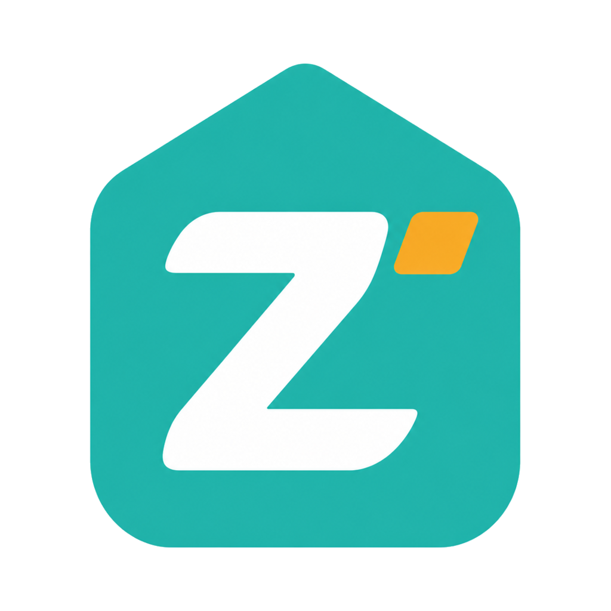

<p align="center">
  
</p>

<h1 align="center">ZPan</h1>

<p align="center">
  <strong>Open-source file hosting for your S3-compatible storage.</strong>
</p>

<p align="center">
  Deploy on Cloudflare Workers or Docker, Upload directly to object storage.
</p>

<p align="center">
  <a href="https://github.com/saltbo/zpan/actions/workflows/ci.yml"></a>
  <a href="https://codecov.io/gh/saltbo/zpan"></a>
  <a href="https://github.com/saltbo/zpan/actions/workflows/release.yml"></a>
  <a href="https://github.com/saltbo/zpan/releases/latest"></a>
  <a href="https://ghcr.io/saltbo/zpan"></a>
  <a href="https://github.com/saltbo/zpan/blob/main/LICENSE"></a>
</p>

<p align="center">
  <strong>English</strong> ·
  <a href="docs/i18n/README.zh-CN.md">简体中文</a> ·
  <a href="docs/i18n/README.ja.md">日本語</a> ·
  <a href="docs/i18n/README.ko.md">한국어</a> ·
  <a href="docs/i18n/README.ru.md">Русский</a> ·
  <a href="docs/i18n/README.es.md">Español</a> ·
  <a href="docs/i18n/README.pt-BR.md">Português (BR)</a>
</p>

<p align="center">
  🎉 <strong>ZPan v2 is here.</strong> To celebrate, we're giving away ZPan Pro three waysfor early stargazers, contributors, and new stars.  <br />See <a href="docs/v2-launch-offers.md"><strong>v2 Launch Offers</strong></a>.
</p>

## What is ZPan?

ZPan is a lightweight file hosting platform built on top of S3-compatible storage. Files upload directly from the client to S3 through presigned URLs, bypassing server bandwidth entirely. The server is the control plane: auth, metadata, shares, WebDAV, API keys, background jobs, and site settings.

The product boundary is intentional: ZPan is a purpose-built S3-backed web drive, not a wrapper around every consumer cloud drive and not a full groupware suite. You bring an S3-compatible bucket; ZPan gives it a clean web UI, public sharing, WebDAV access, and deployment options that do not require a VPS or NAS.

**Core scenarios:**

- **S3 web drive** — Manage files, folders, previews, and trash on top of your own object storage
- **File sharing** — Publish share links with password, expiration, download limits, direct links, and save-to-drive flows
- **External access** — Mount files through WebDAV or use scoped API keys for automation

## Why ZPan?

**S3 only, by design.** ZPan does not chase every net-disk provider or build a cloud-drive nesting layer. The storage contract stays simple and durable: S3-compatible buckets such as Cloudflare R2, AWS S3, Backblaze B2, MinIO, RustFS, Tigris, and other S3-compatible services.

**Cloudflare Workers first.** ZPan is built around Cloudflare Workers, D1, Hono, and web-standard APIs, with Docker and other runtimes as additional deployment targets. You can run a real file-hosting control plane without owning a VPS, keeping a NAS online, or proxying uploads through a long-running server.

**Direct transfer path.** Uploads and downloads use presigned object-storage URLs whenever possible. That keeps server bandwidth low, avoids a central file-transfer bottleneck, and lets object storage do the heavy lifting.

**Practical file workflows.** ZPan includes a web file manager, public sharing, API keys, WebDAV access, file previews, audit logs, and admin controls without turning into a provider-aggregation platform.

**Single-admin by design.** One administrator owns the instance; self-service registration is disabled after the first account is created.

## Product Boundaries

ZPan is a good fit when you want:

- A focused S3-backed web drive instead of a storage-provider zoo
- A self-hosted image bed and file-sharing app backed by your own bucket
- Cloudflare-native deployment without maintaining a VPS or NAS
- Browser-to-S3 transfers instead of app-server file proxying
- Tool integrations for screenshot, publishing, WebDAV, remote download, and API-driven workflows

ZPan is not trying to be:

- A real-time document co-editing suite like Nextcloud Office
- A general-purpose cloud-drive aggregator like AList
- A local server directory browser like File Browser

## How ZPan Compares

Most self-hosted file projects start from either server files, desktop sync, collaboration, or many-provider aggregation. ZPan starts from S3-compatible object storage and a Cloudflare Workers-friendly control plane.

| Capability | **ZPan** | [Cloudreve](https://docs.cloudreve.org/en/) | [AList](https://alist-repo.github.io/docs/guide/drivers/) | [Nextcloud](https://nextcloud.com/files/) | [Seafile](https://www.seafile.com/en/features/) | [File Browser](https://github.com/filebrowser/filebrowser) |
|------------|----------|------------|--------|-----------|---------|--------------|
| S3-backed product focus | ✅ | ❌ | ❌ | ❌ | ❌ | ❌ |
| S3-compatible storage backend | ✅ | ✅ | ✅ | ✅ | ⚠️ | ❌ |
| Direct browser-to-object-storage path | ✅ | ⚠️ | ⚠️ | ❌ | ❌ | ❌ |
| Cloudflare Workers deployment | ✅ | ❌ | ❌ | ❌ | ❌ | ❌ |
| No VPS/NAS required | ✅ | ❌ | ❌ | ❌ | ❌ | ❌ |
| Multi net-disk aggregation | ❌ | ❌ | ✅ | ⚠️ | ❌ | ❌ |
| Server local directory as primary file root | ❌ | ⚠️ | ⚠️ | ⚠️ | ❌ | ✅ |
| Real-time document co-editing | ❌ | ❌ | ❌ | ✅ | ⚠️ | ❌ |
| Dedicated sync clients | Planned | ❌ | ❌ | ✅ | ✅ | ❌ |
| Team/workspace model | ✅ | ⚠️ | ❌ | ✅ | ✅ | ❌ |
| WebDAV access | ✅ | ✅ | ✅ | ✅ | ✅ | ❌ |
| Share links | ✅ | ✅ | ✅ | ✅ | ✅ | ✅ |
| Docker deployment | ✅ | ✅ | ✅ | ✅ | ✅ | ✅ |

Legend: ✅ first-class or core capability; ⚠️ partial, edition-dependent, or not the product's main focus; ❌ not a core capability.

## Deploy

### Cloudflare Workers (Recommended)

There are two supported paths. Choose based on **where the code you want to run lives**.

#### A. Cloudflare Workers Builds — deploy this repository's code

Use this when you maintain your own fork or customisations: connect the repository in the Cloudflare dashboard and every push to `main` builds and deploys automatically, with no GitHub Actions secrets. **The D1 database and KV namespace are created automatically** on the first deploy — `wrangler.toml` contains no account-specific resource IDs.

1. Create/connect a Worker named **`zpan`** from this repository (*Workers & Pages → Create → Workers → Connect to Git*). The name must match `wrangler.toml`.
2. One-time setup: set `ZPAN_USERNAME` + `ZPAN_PASSWORD` under the Worker's **Variables and Secrets** — before the first request. Add **D1:Edit** to the auto-generated `Workers Builds` token if the first deploy reports a D1 authorization error. No D1/KV/rate-limit resources need creating (Wrangler auto-provisions D1 + KV; the rate limiter's `namespace_id` is just an account-local integer).
3. Set **Build command** = `pnpm workers-builds:build`, **Deploy command** = `pnpm workers-builds:deploy`, **Production branch** = `main`. The deploy command runs `wrangler deploy` first so the database exists, then applies D1 migrations.
4. Remove the four Cloudflare **Actions** secrets (or disable the deploy workflow) so a push is not deployed twice.

Full checklist, Deploy-to-Cloudflare button, optional resource pinning, WebDAV post-processing and troubleshooting: [Deploy with Cloudflare Workers Builds](docs/deploy/workers-builds.md).

#### B. GitHub Actions — deploy the upstream release (forks)

> This workflow checks out the **upstream `saltbo/zpan` release tag**, not your fork's source. Local customisations are **not** included — use path A for those.

Deploy via GitHub Actions with zero server management. Free tier covers personal use.

1. **Fork** this repository
2. In your fork, go to **Settings → Secrets and variables → Actions** and add:
   - `CLOUDFLARE_ACCOUNT_ID` — found on the [Cloudflare dashboard](https://dash.cloudflare.com/) sidebar
   - `CLOUDFLARE_API_TOKEN` — create one [here](https://dash.cloudflare.com/profile/api-tokens) with **Workers Scripts:Edit** and **D1:Edit** permissions
   - `ZPAN_USERNAME` and `ZPAN_PASSWORD` — the single administrator's login identity (an email address) and password. Self-service sign-up is disabled, so the instance seeds this account from these secrets on its first request. Set them **before the first deploy**; adding them later requires a new deployment because the seed runs once per isolate.
   
   `BETTER_AUTH_SECRET` is **not** configured separately: the app derives a fixed 64-character signing key from `ZPAN_USERNAME` + `ZPAN_PASSWORD` using HMAC-SHA256. The key is stable across restarts and isolates, needs no backup, and rotates automatically when either credential changes (invalidating existing sessions). If an explicit `BETTER_AUTH_SECRET` is present from an older deployment it takes precedence — delete it with `pnpm exec wrangler secret delete BETTER_AUTH_SECRET` to switch to the derived key.
3. Go to the **Actions** tab, select **Deploy to Cloudflare Workers**, and click **Run workflow**

After initial setup, the workflow runs automatically every time you sync your fork with the latest release.

This `CLOUDFLARE_API_TOKEN` is the **deployment token** used only by GitHub Actions/Wrangler to deploy ZPan and manage its D1 resources. It does not need broad account permissions.

Dedicated WebDAV domain: enable WebDAV and configure its optional hostname in Admin Settings, then extend the API token with **Transform Rules:Edit**. When the hostname is left blank, a primary Worker Custom Domain such as `files.example.com` produces `dav.files.example.com`; the deployment workflow automatically attaches and verifies that derived hostname, manages the root-to-`/dav` rewrite, and records its readiness. Other deployments can verify their manually configured DNS/proxy from **Admin Settings → WebDAV**. Until verification succeeds, ZPan advertises the original `/dav/` endpoint. See [WebDAV custom domains](docs/webdav-custom-domain.md).

### AWS Lambda

Deploy via GitHub Actions using SAM. Lambda Function URL provides HTTPS with no API Gateway needed.

1. **Fork** this repository
2. In your fork, go to **Settings → Secrets and variables → Actions** and add:
   - `TURSO_DATABASE_URL` and `TURSO_AUTH_TOKEN` — from [Turso](https://turso.tech) (free, no credit card)
   - `AWS_ACCESS_KEY_ID`, `AWS_SECRET_ACCESS_KEY`, `AWS_REGION`
3. Go to the **Actions** tab, select **Deploy to AWS Lambda**, and click **Run workflow**

See [docs/deploy/aws-lambda.md](docs/deploy/aws-lambda.md) for full setup instructions and IAM permissions.

### Docker

**Quick start** — pull the pre-built image and bring your own S3 storage:

```bash
curl -O https://raw.githubusercontent.com/saltbo/zpan/main/deploy/docker-compose.yml
docker compose up -d
```

**With RustFS** (self-hosted S3-compatible storage, no external dependencies):

```bash
curl -O https://raw.githubusercontent.com/saltbo/zpan/main/deploy/docker-compose.rustfs.yml
docker compose -f docker-compose.rustfs.yml up -d
```

After startup:

1. Open the RustFS console at `http://localhost:9001` (admin / admin123) and create a bucket (e.g. `zpan-bucket`)
2. Open ZPan at `http://localhost:8222`, register a user (first user gets admin role)
3. Go to **Admin → Storage** and add the RustFS storage:
   - **Endpoint**: `http://localhost:9000` (must be reachable from your browser, not the Docker internal hostname)
   - **Bucket**: the bucket name you created in step 1
   - **Region**: `us-east-1`
   - **Access Key / Secret Key**: `admin` / `admin123`

> **Important:** The storage endpoint must be accessible from the **client browser**, since files upload directly to S3 via presigned URLs. Use `http://localhost:9000` for local development, or your server's public URL for production.

## Documentation

- [v2 Launch Offers](docs/v2-launch-offers.md) — earn ZPan Pro for free
- [Roadmap](V2_ROADMAP.md)
- [Contributing](CONTRIBUTING.md)

## v1

Looking for ZPan v1 (Go version)? See the [v1 branch](https://github.com/saltbo/zpan/tree/v1).

## Contributing

See [CONTRIBUTING.md](CONTRIBUTING.md) for details.

Thank you to all the people who contributed to ZPan!

<a href="https://github.com/saltbo/zpan/graphs/contributors"></a>

## License

ZPan is under the GNU Affero General Public License v3.0. See the
[LICENSE](LICENSE) file for details.
